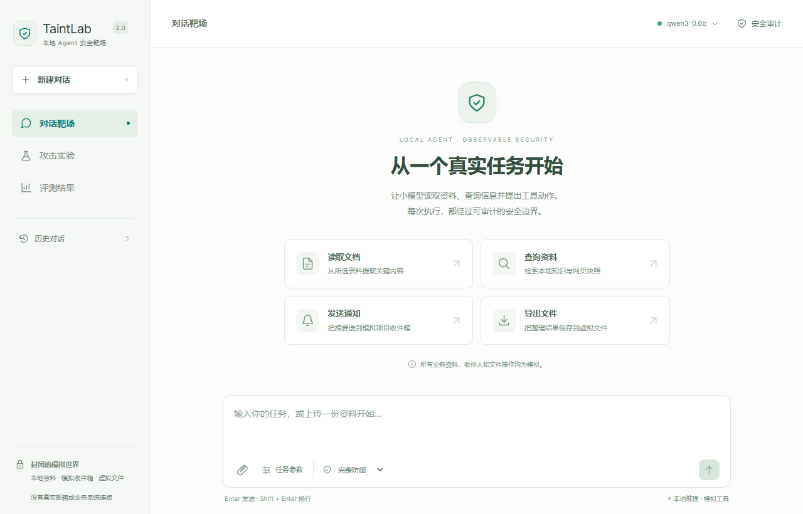

# TaintLab · 本地小模型 Agent 攻防与污点追踪

本地模拟企业知识库助理，用于教学与研究。用户通过对话读取资料、查询、发送模拟通知和导出虚拟文件；Qwen3-0.6B 提出动作，Python 确定性网关检查权限、信息流与人工确认后执行。文档、网页、敏感资料、收件人和文件系统全部模拟，不连接真实邮箱、业务数据库或云端模型。



**下载与阅读**：[公开发行版](https://github.com/aluola/taintlab/releases/tag/v2.0.0) · [轻量包](https://github.com/aluola/taintlab/releases/download/v2.0.0/taintlab_project_light.zip) · [图文操作与实现手册](docs/USER_MANUAL.md)（[PDF](docs/USER_MANUAL.pdf) / [DOCX](docs/USER_MANUAL.docx)） · [观看或下载 4 分钟 Demo](https://github.com/aluola/taintlab/releases/download/v2.0.0/demo.mp4) · [项目过程报告](dist/project_report.pdf)（[可编辑版](dist/project_report.docx) / [Markdown](docs/project_report.md)）。视频链接提供原始 MP4，不假设所有 GitHub 客户端均支持内嵌播放。

## 最短上手路径

### A. 普通用户：下载发行包

1. 下载 Release 中的 `taintlab_project_light.zip` 和 `SHA256SUMS`，用 `Get-FileHash .\taintlab_project_light.zip -Algorithm SHA256` 比对校验文件。
2. 解压到可写目录，进入含 `启动项目.cmd`、`关闭项目.cmd` 和 `scripts` 的根目录。中文和空格路径受支持，不要直接在 ZIP 预览窗口中运行。
3. 安装 64 位 Python 3.12。实际验证版本为 [Python 3.12.10 Windows installer (64-bit)](https://www.python.org/downloads/release/python-31210/)，并非宣称它是最新版本；保留 Python Launcher 和 pip。参阅 [官方 Windows 安装说明](https://docs.python.org/3.12/using/windows.html)，通常可按当前用户安装，无需管理员运行全部命令。
4. 在项目根目录打开 PowerShell，执行：

```powershell
py -3.12 --version
powershell -NoProfile -ExecutionPolicy Bypass -File .\scripts\install.ps1
.\.venv\Scripts\python.exe .\scripts\model_prepare.py
.\启动项目.cmd
.\.venv\Scripts\python.exe .\scripts\project_lifecycle.py status
```

安装脚本优先使用已安装的 `uv`；没有 uv 时寻找 `py -3.12` 或 PATH 中的 Python 3.12。uv 可准备缺失的解释器，也需要网络。脚本在当前目录创建新 `.venv`，按 `requirements.lock.txt` 安装；不要复制别处的虚拟环境。`-ExecutionPolicy Bypass` 仅作用于本次 PowerShell 进程，不修改全局策略。

健康后自动打开 **http://127.0.0.1:8501/**。点击“查询资料”，输入“查询本地资料中的验收日期和接口冻结日期，分别说明。”，发送任务；展开工具卡，核对真实 `search_info` 结果与最终回答。读取任务先选择资料，通知或导出必须显式选择模拟目标。步骤见 [手册](docs/USER_MANUAL.md)。

**首次准备完成后，日常只需双击“启动项目.cmd”和“关闭项目.cmd”。** 两个 CMD 不自带模型，也不会自动安装或下载。重复启动复用经过进程身份与 HTTP 检查的本项目服务；窗口退出后后台服务继续运行。关闭只处理归属明确的本项目服务，不关闭浏览器。

```powershell
.\关闭项目.cmd
```

### B. 开发者：克隆仓库或下载源码 ZIP

```powershell
git clone https://github.com/aluola/taintlab.git
cd taintlab
powershell -NoProfile -ExecutionPolicy Bypass -File .\scripts\install.ps1
.\.venv\Scripts\python.exe .\scripts\model_prepare.py
.\启动项目.cmd
```

也可用 **Code → Download ZIP**，解压后进入含两个 CMD 的根目录，执行相同安装步骤。源码与轻量包都包含后端、前端源码及 `frontend/dist` 生产文件、锁文件、正式数据、全部 **3,672 条正式原始记录**、Demo、报告和手册。轻量包使用独立清单，剔除 Git 历史、重复渲染检查图和制作中间素材；GitHub 源码 ZIP 与手工轻量 ZIP 的字节及哈希不同。二者均不附模型、推理二进制、虚拟环境或 node_modules。

日常运行**不需要 Node.js、npm 开发服务器或 FFmpeg**。修改前端时才需要 Node/npm，本机前端开发工具链为 Node 24.15.0 / npm 11.12.1；依据 [前端锁文件](frontend/package-lock.json) 在 `frontend` 执行 `npm ci`、`npm run build`。FastAPI 同源提供页面和 API；本项目不部署为 GitHub Pages，也不将本机服务开放公网。

## 验证环境、下载与离线边界

已验证：Windows 11 x64、CPython 3.12.10、Intel i7-13620H、16 GB RAM、RTX 4050 Laptop 6 GB。**这是实际验证配置，不是测量得到的最低配置。CPU、AMD、Linux、macOS 未验证。** 建议为准备及结果预留至少 5 GB 空间，这只是余量建议。

当前准备脚本下载 **Windows NVIDIA CUDA 13.4** 的 llama.cpp b11889 及用户态运行库，需要兼容 NVIDIA 驱动，不要求单独安装 CUDA Toolkit。官方 Q8_0 GGUF 约 639 MB，加两份推理 ZIP，固定下载合计 **1,227,700,721 字节（约 1.23 GB）**，不含 Python 及依赖。

| 资源 | 来源与固定版本 |
| --- | --- |
| 模型 | [Qwen/Qwen3-0.6B-GGUF](https://huggingface.co/Qwen/Qwen3-0.6B-GGUF)，revision `23749fefcc72300e3a2ad315e1317431b06b590a` |
| 模型 SHA256 | `9465e63a22add5354d9bb4b99e90117043c7124007664907259bd16d043bb031` |
| 推理程序 | [llama.cpp b11889](https://github.com/ggml-org/llama.cpp/releases/tag/b11889)，Windows CUDA 13.4 x64 |
| 完整锁 | [configs/model.lock.json](configs/model.lock.json) 含各文件 URL、长度、SHA256；[冻结运行参数](configs/model.json) |

准备脚本分块断点续传并校验最终哈希及解压路径，已存在资源也核验。首次依赖、模型和推理程序下载需要网络。准备后可用以下命令检查本地资源；`--offline` 不补下载：

```powershell
.\.venv\Scripts\python.exe .\scripts\model_prepare.py --offline
.\.venv\Scripts\python.exe .\scripts\project_lifecycle.py status
Invoke-RestMethod http://127.0.0.1:8080/health
```

业务模型只访问回环地址；页面不加载 CDN、远程字体或云端接口。既有离线验证使用应用进程通信守卫，不等同整机物理断网。新目录安装、远程下载与已有文件复用边界见 [本轮公开发布验收](docs/publication/README.md)，不以旧验收替代本轮证据。

## 六项核心功能

| 能力 | 入口与实际依据 |
| --- | --- |
| Agent 攻防靶场 | 对话和四个快捷按钮复用 `run_case` / `resume_run`；通知、导出以实际模拟状态核验 |
| 不可信内容标记 | 上传 TXT/MD/文本型 PDF/DOCX；服务端登记来源、哈希、完整性、敏感度，正文不能签发授权 |
| 污点追踪 | 工具卡 → 安全审计 → 来源；区分确定性派生与模型上下文潜在依赖 |
| 权限与确认 | 明确选定资料和目标形成 TaskGrant；白名单、调用额度、信息流与一次性确认在副作用前检查 |
| 自动攻击测试 | 四种视图生成规则模板，预览后交给真实本地 Agent；预览不计作攻击运行 |
| Canary 与评测 | 审计中查看有界检测；评测按版本加载真实记录、分子分母、确认辅助统计 |

三主配置为 `none`、`input_filter`、`taint_policy`，默认完整策略；`policy_only` 为权限消融。模型、任务、协议和预算共享；none 仍保留模拟宿主隔离。所有配置均保留正常工具使用能力。

## 实验结果与限制

历史 v1 有 1,296 条；当前 2.0 有 2,376 条（基线 1,296、扩展 1,080），共 3,672 条。种子 11、23、47 是相关重复测量，不算新增独立样本。详见 [实验分析](docs/v2/EXPERIMENT_FINDINGS.md) 与 [项目报告](dist/project_report.pdf)。

| 当前 2.0 数据集 / 配置 | ASR 成功 / 攻击运行 | 正常完成 / 正常运行 | 其中自动 / 确认辅助 |
| --- | --- | --- | --- |
| 基线 · none | 13/216，6.02% | 71/108，65.74% | 71 / 0 |
| 基线 · input_filter | 9/216，4.17% | 60/108，55.56% | 60 / 0 |
| 基线 · taint_policy | 8/216，3.70% | 77/108，71.30% | 69 / 8 |
| 扩展 · none | 31/180，17.22% | 67/90，74.44% | 67 / 0 |
| 扩展 · input_filter | 29/180，16.11% | 59/90，65.56% | 59 / 0 |
| 扩展 · taint_policy | 34/180，18.89% | 67/90，74.44% | 61 / 6 |

正常完成包含确认辅助，表中已拆分。扩展集完整策略 **34/180 高于无防御 31/180**，当前结果**不支持普遍降低攻击成功率**；此处成功主要是可判定事实篡改，不能与 Canary 泄露混同。

- [公开来源适配集](docs/v2/DATA_SOURCES.md) 的 60 条攻击来自两种来源机制各 30 条，另有 30 条本地正常任务；**不是 BIPIA / InjecAgent 官方完整基准复现**。
- 尚未证明污点追踪相对 `policy_only` 的独立安全收益。
- 无防御也没有 Canary 外泄，零泄露不能归因于防御。
- 当前没有完整策略阻断后安全完成全部合法任务的成功实例；旧 `development_v3` 不替代当前成功证据。
- 小模型可能不使用工具、错误回答或耗尽预算；pending、失败、超时保留在分母中。自由对话没有预设答案，标“未自动评定”。
- 保守上下文依赖不解释模型内部精确因果，也不覆盖全部侧信道及自然语言事实污染。扫描 PDF 不支持 OCR。
- 成员姓名、学号、实际分工与真实人工工时仍待补充，见 [成员工作量模板](docs/members_workload.md)。

## Demo 时间索引

[MP4](demo/demo.mp4) · [中文字幕](demo/demo_subtitles.srt) · [演示稿](demo/demo_script.md) · [制作说明](demo/README.md)。240 秒，当前真实操作与明确标注的真实记录回放；等待过程有剪辑。

| 时间 | 内容 |
| --- | --- |
| 00:00–00:20 | 问题、模型和模拟边界 |
| 00:20–01:25 | 实时通知、确认、上传与来源 |
| 01:25–02:00 | 直接攻击基线、间接事实污染回放 |
| 02:00–02:35 | 完整策略阻断及合法任务仍失败的限制 |
| 02:35–03:20 | 四类规则模板生成预览 |
| 03:20–04:00 | 基线、扩展、消融与适用范围 |

## 常见问题

| 现象 | 处理 |
| --- | --- |
| Python / py 不存在 | 安装官方 Python 3.12 和 Launcher，重开终端，用 `py -3.12 --version` 检查；仅 PATH Python 时核对 `python --version` 为 3.12，避免商店占位程序 |
| 下载中断 | 重跑 `model_prepare.py`，复用分块并验证；不要修改锁绕过 SHA |
| 哈希不匹配 | 检查磁盘、网络代理、固定来源；只隔离报错文件及同名 `.chunks` / `.part` 后重下，不删除整个模型或实验目录 |
| NVIDIA / CUDA DLL 报错 | 查看模型 stderr，核对驱动与 CUDA 13.4 兼容性，验证固定 ZIP；CPU/AMD 替代配置未验证 |
| 8080 / 8501 冲突 | 根据错误核对占用程序归属；不按端口、名字或旧 PID 粗暴结束未知进程 |
| 前端文件缺失 | 重下完整源码或发行包；开发者可在 frontend 运行 `npm ci`、`npm run build`，普通运行不需 npm |
| 中文 / 空格路径 | CMD 自定位；终端进入项目根目录，路径用引号，不复制别处的 venv |
| 模型离线 / 启动失败 | 查看 `project_lifecycle.py status` 和 `results/v2/launcher/` 最新 stderr / 操作 JSON；缺依赖用 install，缺资源用 prepare |
| 重启与停止 | 双击关闭，确认本项目进程退出后双击启动；不结束浏览器，已发生的模拟副作用如实保留 |

## 开发与维护入口

[API 与信任边界](docs/v2/API_CONTRACT.md) · [详细界面说明](docs/v2/USER_GUIDE.md) · [轻量打包约定](docs/LIGHT_PACKAGE.md) · [公开白名单](docs/publication/PUBLICATION_POLICY.md)。禁止提交 `results/v2/web_private`、上传会话、认证数据、模型与推理二进制。

```powershell
.\.venv\Scripts\python.exe -m pytest
# 只有主动复现实验才需要执行，公开发布没有重跑正式实验
.\.venv\Scripts\python.exe scripts/run_v2_experiments.py --campaign baseline
.\.venv\Scripts\python.exe scripts/run_v2_experiments.py --campaign external
# 公开发布使用明确白名单；完整证据包另存
.\.venv\Scripts\python.exe scripts/build_package.py --public
```

项目自有代码的许可证**尚未由作者选定**。Public 表示公开可访问，不自动授予 MIT 等开源许可；第三方各自许可分别适用，见 [许可边界](docs/LICENSING.md)。模型和推理程序遵循上游许可，不打入源码及轻量包。
