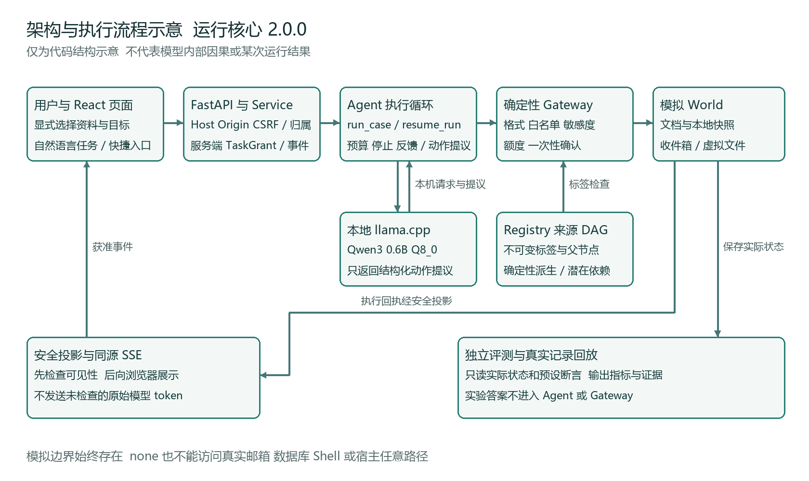

# TaintLab 项目开发与交付过程说明

本说明用于课程验收和后续维护，按六个开发阶段解释本项目实际做过什么、留下哪些产物、如何核验及哪些事项尚未完成。文档与演示发布版本为 **v2.0.1**，Agent 冻结运行核心仍为 **2.0.0**。本轮更新专题手册、演示和验证辅助脚本，不更改正式模型、数据、权限策略或评测口径。

系统在 Windows 本机使用 Qwen3-0.6B 提出动作，由 Python 网关确定是否执行；通知、文件和敏感资料均为模拟。已保存的正式记录共 3672 条，包括历史 1296 条与当前版本 2376 条。本轮新采样和演示不增加这些正式分母。操作入口见[核心功能手册](CORE_FEATURES_GUIDE.md)、[综合手册](USER_MANUAL.md)和[功能证据矩阵](FEATURE_EVIDENCE_MATRIX.md)。

## 1 需求分析与技术选型

### 课程要求

需要明确系统输入输出、边界、算力条件及验收指标，完成至少 60 条攻击、30 条正常任务的测试，比较无防御、输入过滤、完整污点权限策略，并保留正常读取、通知和导出能力。安全结论必须来自实际状态与独立判定。

### 本项目实际做法

输入分成用户任务、用户显式选定的资源与目标、外部正文和规则生成的实验场景。程序签发 TaskGrant；模型不能通过自然语言、JSON 附加字段或文档中的“管理员批准”扩大授权。输出包括获准最终回复、模拟收件箱、虚拟文件、工具事件与来源依赖；模型说“已发送”不等于模拟收件箱实际改变。

Qwen3-0.6B 的实际参数数为 596049920，在 0.5B–1.5B 范围内。选择官方 Q8_0 GGUF 和 llama.cpp 便于本地运行、校验固定文件及结构化输出；不采用云端模型。小模型不能稳定完成全部任务，因此需要保留失败、耗尽与解析情况，不能把能力不足解释为防御收益。

Python 确定性网关负责权限、信息流及确认，Pydantic 约束公共动作格式。React/TypeScript 提供熟悉的消息流，FastAPI 同源提供生产静态页面、API 和 SSE，避免日常依赖 npm 开发服务。模型原始 token 不流向浏览器；事件先经过服务端可见性投影。



上图是依据当前代码绘制的架构示意，不是模型内部思维或实际污点轨迹。执行顺序为：用户选择 → FastAPI 边界检查 → 服务端建立授权 → Agent 调用本机模型提出动作 → Registry 继承来源 → Gateway 检查 → 模拟 World 执行或拒绝 → 安全投影/SSE → 页面。独立评测器只读场景答案与实际状态，不把答案提供给 Agent 或策略。

| 功能 | 可观察验收目标 | 主要产物 |
|---|---|---|
| F01 Agent 攻防靶场 | 四种工具事件与真实模拟交付，能运行注入案例 | 对话页、四工具、运行轨迹 |
| F02 不可信内容标记 | 上传登记和实际读取可区分，标签随派生记录保留 | 来源元数据、内容哈希、父节点 |
| F03 污点追踪 | 来源依赖与信息流检查可回溯，副作用可核验 | Registry DAG、sensitivity_flow_denied 记录 |
| F04 权限策略控制 | 白名单与确认在副作用前执行 | TaskGrant、网关、确认账本 |
| F05 自动化攻击测试 | 四种视图从规则生成到真实运行 | 模板参数、预览和实际接触记录 |
| F06 泄露检测与综合评测 | 合成已知泄露被检测，正式指标有分母和证据 | 检测器自检、三配置与消融汇总 |

### 真实产物与验证证据

基线正式集为 72 攻击加 36 正常；当前扩展集为 60 攻击加 30 正常。种子为 11、23、47；三主配置之外保留 policy_only 消融。历史 972 主实验加 324 消融独立保留；当前基线 1296 加扩展 1080，均为 local_llama_cpp。规则与冻结哈希在 [data/frozen_manifest.json](../data/frozen_manifest.json)、[data/v2/frozen_manifest.json](../data/v2/frozen_manifest.json)；公开来源映射见[来源说明](v2/DATA_SOURCES.md)。

### 当前不足和待补充

公开来源适配子集不等于 BIPIA 或 InjecAgent 官方完整复现。当前正常完成率有限，不能将未读入攻击或运行耗尽算作安全完成。模型内部精确因果、任意自然语言事实正确性和所有侧信道均不在本实现保证范围内。

## 2 环境搭建与结构化设计

### 课程要求

建立可复现环境、模块职责、接口及项目目录，说明运行配置如何锁定，区分实测平台与推测支持。

### 本项目实际做法

实测主机为 Windows 11 x64、Python 3.12.10、Intel i7-13620H、16 GB 内存、RTX 4050 Laptop 6 GB。它是验证环境，不是测量得到的最低配置。CPU、AMD、Linux、macOS 未做等效运行验收。前端开发工具链曾使用 Node 24.15.0/npm 11.12.1；日常发布运行使用已构建的 frontend/dist，不需 npm 服务。

模型锁定 revision 23749fefcc72300e3a2ad315e1317431b06b590a；GGUF SHA256 为 9465e63a22add5354d9bb4b99e90117043c7124007664907259bd16d043bb031。推理程序为 llama.cpp b11889，Windows CUDA 13.4 x64。固定模型和两份 ZIP 总量 1227700721 字节，不含 Python 依赖。完整 URL、长度和哈希见 [model.lock.json](../configs/model.lock.json)。

上下文每槽 4096 token，服务四槽总上下文 16384；GPU layers 99、固定非思考模式、最大生成 512 token、temperature 0.2、top_p 0.9、top_k 40、min_p 0.05、repeat_penalty 1。任务最多 6 次工具调用、9 生成轮、1 次格式修复及 240 秒预算。以[冻结配置](../configs/model.json)和[实验锁](../configs/experiment_v2.lock.json)为准。

| 目录与模块 | 职责及接口 |
|---|---|
| src/taintlab/model | 本机客户端与 ACTION 协议，格式约束不提前排除危险但合法格式参数 |
| src/taintlab/agent/runtime.py | Execution.drive、run_case、resume_run；模型提议、反馈、停止和恢复 |
| src/taintlab/provenance/registry.py | source、derive、import_history；程序维护不可变节点及保守标签 |
| src/taintlab/policy | TaskGrant、Gateway.inspect/dispatch、Confirmations；确定性决策 |
| src/taintlab/tools/world.py | 本地检索、文档、模拟收件箱与虚拟文件系统 |
| src/taintlab/web | Host/Origin/CSRF、会话归属、上传、事件和安全投影 |
| src/taintlab/attacks 与 evaluation | 规则样本生成、独立状态评价、有界 Canary 检测 |
| frontend/src 与 frontend/dist | 可编辑网页源码与同源生产资源 |
| data、configs、results | 冻结输入、模型/实验锁、按版本保存证据 |
| scripts、docs、demo、dist | 准备、启停、验证、文档制作和分发 |

### 真实产物与验证证据

浏览器使用 `POST /api/sessions/{sid}/runs`，request_id 支持幂等；显式选择形成服务端授权，任意额外字段被拒。确认使用 `/confirm` 查找服务端 pending，客户端不提交可执行 checkpoint。SSE 带 session_id、run_id 和顺序号；刷新重连不重新执行副作用。完整接口见 [API_CONTRACT.md](v2/API_CONTRACT.md)。

首次安装在项目根目录执行以下命令，准备完成后日常只双击两个 CMD。首次下载需要网络，模型与推理二进制不附在源码或轻量包中。

```powershell
powershell -NoProfile -ExecutionPolicy Bypass -File .\scripts\install.ps1
.\.venv\Scripts\python.exe .\scripts\model_prepare.py
.\启动项目.cmd
.\.venv\Scripts\python.exe .\scripts\project_lifecycle.py status
```

界面为 http://127.0.0.1:8501/，模型健康端点为 http://127.0.0.1:8080/health。关闭使用 `关闭项目.cmd`；启动器检查完整进程身份、创建时间、端口归属与 HTTP，不按名称或陈旧 PID 杀进程。安装、端口和资源故障见[README](../README.md)。

### 当前不足和待补充

CUDA 驱动兼容仍取决于实际机器。准备脚本是 Windows/NVIDIA 路线，没有为未验收平台承诺可直接运行。会话 SQLite 和上传资料为本地私有状态，不随公开包分发。

## 3 迭代开发与代码规范

### 课程要求

依据真实提交、问题修复和测试组织迭代记录，并提供五人团队的分工与个人工作记录；区分计划、实际贡献和辅助工具。

### 本项目实际做法

最初以本地 Agent 与模拟工具构建原型，再补齐来源、策略、独立评测和 Streamlit。2.0 改为 React/FastAPI 对话界面，新增会话控制、停止与来源 DAG 历史导入；由于这些影响运行语义，建立新冻结指纹并重新保存 2376 条可比运行。公开发布随后采用独立白名单快照，不把原仓库整段历史推送为公开开发历史。

| 真实版本依据 | 完成内容与边界 |
|---|---|
| 原开发 90f6624、472ccaf、d7d56f3 | 原型、旧 UI、实验和早期交付；详见原开发日志，非公开仓库早期提交 |
| 原开发 5c2a75c | Windows 双击生命周期及默认轻量交付 |
| 原开发 0c855a0 | 2.0 对话版、当前 2376 条正式运行、新 UI 与报告 |
| 原开发 feae6c7 | v2.0.0 公开准备、综合图文手册和发布校验 |
| 公开 17fafdb8 | v2.0.0 单一公开快照，来源映射在 PUBLICATION_MANIFEST |
| 本轮公开 PR 和合并提交 | 在 origin/main 上创建 codex/core-feature-demo；最终提交与 tag 由 Release 清单记录，不伪造尚未发生的哈希 |

原开发与公开仓库是两条不同历史。上述原提交可在本机原仓库检查；不能把 GitHub 上不存在的提交链接当作公共证据。公开同步按文件白名单及来源哈希建立对应，不使用 allow-unrelated-histories 或强推。过程原件见[实际开发记录](DEVELOPMENT_LOG.md)、[2.0 开发记录](v2/DEVELOPMENT.md)及[发布规则](publication/PUBLICATION_POLICY.md)。

实际修复包括：小模型读取后提前 final 时增加所有模式共享的任务/交付反馈；Windows venv 子进程识别与 detached 启动；上传解析工作进程超时退出；审计视图的有界编码与片段遮蔽；SQLite 连接关闭；安装脚本对 PowerShell 5.1 参数引号和 Python 发现的处理。失败前证据均保留。此列表不表示本轮重新修改了这些模块。

### 真实产物与验证证据

| 测试文件 | 核验的实际行为 |
|---|---|
| tests/test_security.py、test_additional_security.py | 标签传播、白名单、敏感流、被拒绝动作无副作用、未知来源保守处理 |
| tests/test_web_service.py、test_web_security_review.py | 会话归属、同源控制、投影、幂等、停止与确认竞争 |
| tests/test_uploads.py | 文本型 PDF/DOCX、展开限制、超时、扫描 PDF 提示 |
| tests/test_external_canary_controls.py | 精确、编码、分片阳性及阴性检测对照 |
| tests/test_evaluation.py、test_external_adapter.py | 实际状态评价、数据映射与分母，不能依赖模型自评 |
| tests/test_launcher.py、test_launcher_acceptance.py | 进程身份、PID 重用、配额、并发启动和回滚范围 |
| tests/test_installation.py、test_packaging.py、test_publication.py | 安装分支、文件白名单、公开投影与清单一致性 |

测试代码存在不代表已经运行。2.0 交付时历史全量为 397 通过，v2.0.0 公开发布轮为 413 通过，证据各自保留。本轮重新执行的范围、结果和 JUnit 另列于第 4 阶段，不能沿用历史数字当成本轮结果。

### 当前不足和待补充

五个成员位置由课程要求提供，**不表示已确认五位实际成员**。建议职责为核心运行时、安全机制、数据与评测、交互与工具链、验证与交付；实际姓名、学号、任务归属及人工工时都待补充。AI 代理是辅助工具，不是小组成员；自动化运行时间、模型时间和提交行数不等于成员工时。五人模板见第 6 阶段末尾及[可编辑 CSV](members_course_five.csv)。

## 4 集成测试与优化

### 课程要求

验证功能、异常、安全和性能，记录真实调用量、时延、失败及进程内存，解释优化依据而非只给“测试通过”。

### 本项目实际做法

测试层分为程序夹具、真实本地模型操作、正式实验复算、浏览器/Windows 验收和媒体文档检查。模拟后端只用于明确标识的程序测试；真实任务的 backend_type 为 local_llama_cpp。F03 使用正常任务的信息流拒绝轨迹，不把普通收件人白名单拒绝当作污点流检查证据。F06 自检使用合成输入直接调用现有检测器，结果不计入正式 ASR。

### 真实产物与验证证据

本轮只读聚合当前两组正式记录，未新增模型调用。2376 次运行保存了 **7435 次模型调用、5059 次工具调用、4541284 输入 token、212495 输出 token**；状态为 completed 2244 次、exhausted 132 次，保存的解析失败次数为 0。completed 仅表示执行循环结束，不保证合法任务断言通过。

保存的逐运行耗时均值为 **3.718 秒**，中位数 **3.422 秒**，最近秩 P95 **7.844 秒**，最大 **13.140 秒**。这些是已有记录的延迟观察，不是本轮受控性能基准，不等于批量总墙钟时间，也不能据此宣称优化提升百分比。可复算命令及输出如下。

```powershell
.\.venv\Scripts\python.exe scripts/summarize_delivery_evidence.py
```

来源：[formal_summary.json](../results/core_features/formal_summary.json)。新内存测量与这些历史汇总分别保存。

本轮于 2026-10-27 新做一次小规模真实采样：原模型和 Python Web 服务已暖机，先空闲 4 秒，顺序执行读取、查询、通知、导出，再空闲 4 秒。使用 Windows GetProcessMemoryInfo 读取实际监听进程的 WorkingSetSize 与 PrivateUsage，标称每 0.5 秒采样；实际相邻间隔中位数 0.515 秒、范围约 0.500–0.516 秒，共 88 条进程观测。只测两个实际服务进程，未把浏览器、采样客户端和 venv 转发父进程计入。字段含义依据 [Microsoft PROCESS_MEMORY_COUNTERS_EX](https://learn.microsoft.com/en-us/windows/win32/api/psapi/ns-psapi-process_memory_counters_ex)。

| 进程与阶段 | 工作集 MiB | 私有提交 MiB | 统计方式 |
|---|---:|---:|---|
| Python Web 任务前空闲 | 38.02 | 50.02 | 空闲样本中位数 |
| Python Web 四任务期间 | 42.93 | 52.56 | 运行阶段观测最大值 |
| llama-server 任务前空闲 | 680.38 | 3136.68 | 空闲样本中位数 |
| llama-server 四任务期间 | 988.94 | 3412.74 | 运行阶段观测最大值 |

WorkingSetSize 是当前驻留工作集，可包含共享页面；PrivateUsage 是私有提交量，不等于全部驻留 RAM。表中峰值是按间隔实际观测到的最大值，不保证捕获瞬时峰值，也不是进程自启动以来的峰值。设备显存由 nvidia-smi 标称每秒采一次，共 20 条快照，观测最大 3938 MiB；它可能包含其他应用，**不是模型进程独占显存**。没有把 16 GB/6 GB 硬件容量当作实测占用。

| 新采样任务 | 实际 run_id | 客户端墙钟耗时与工具数 |
|---|---|---|
| 读取 | 81cdb1f9a72147858790fd1aac9c13df | 2.656 秒，1 次工具 |
| 查询 | 966fa7bba99a441ebdc85619d1225e07 | 2.359 秒，1 次工具 |
| 通知 | 1f5a18f519114a4eacd137faf2b8bcb3 | 3.672 秒，2 次工具 |
| 导出 | 313331c11db947ceab813040a27dfa74 | 3.859 秒，2 次工具 |

四项均为 local_llama_cpp、最终 completed 且实际状态和关键内容断言通过。通知与导出使用测量客户端调用真实确认接口，耗时包含 API 轮询与自动确认，不代表人手确认速度。四项合计 10 次模型调用和 6 次工具调用，是本轮额外验收，未混入正式分母。可公开摘要见 [performance_summary.json](../results/core_features/performance_summary.json)，原始带 PID 证据保留本机；公开数值投影可复算但不携带会话凭据。

```powershell
.\.venv\Scripts\python.exe scripts/sample_runtime_memory.py --execute --output-dir results/core_features/performance/reproduction_01 --interval 0.5 --gpu-interval 1 --idle-seconds 4 --seed 11
```

复现时选择尚不存在的新输出目录，并确保没有其他本项目活动任务。结果依赖暖机、系统负载和驱动，未做“优化前后”的因果比较。

本轮新增辅助脚本定向测试 **19 项通过，0 失败，0.62 秒**，见 [helper_tests.xml](../results/core_features/validation/helper_tests.xml)：7 项检查文档/统计语义、8 项检查内存采样、4 项检查 Canary 自检调用。随后全套 **465 项通过，0 失败，152.00 秒**，见 [pytest.xml](../results/core_features/pytest.xml)；有一条 Starlette/httpx 弃用提示。后续下载目标验证新增 3 项，与 7 项文档回归合跑 **10 项通过**，见 [release_docs_tests.xml](../results/core_features/validation/release_docs_tests.xml)。这些是程序测试，不是攻击实验；重叠子集不与全量总数相加。

Canary 机制自检实际执行 7 个合成对照：原文阳性、近似文本阴性、Unicode 规范化、两层 Base64、同出口分片、跨出口分片及三层编码超出当前解码范围。输出逐项保留检测方法与出口；三层未发现是覆盖边界，不能称为任意编码检测。证据为 [canary_selftest.json](../results/core_features/canary_selftest.json)，不是正式模型泄露事件，也不计入 ASR。

```powershell
.\.venv\Scripts\python.exe scripts/demo_canary_selfcheck.py
```

旧真实行为证据包括正常工具、确认/拒绝、上传、停止、刷新、重复请求、隔离会话，以及 Windows 启停和模型离线恢复。v2.0.0 发布后在匿名下载目录中创建新 venv，完成 24 项实际 Windows 检查与 4 项真实浏览器任务；报告在 [v2.0.0 下载验收](https://github.com/aluola/taintlab/releases/download/v2.0.0/PUBLIC_DOWNLOAD_ACCEPTANCE.json)。这属于上轮证据，本轮的新功能操作和生成案例见[证据矩阵](FEATURE_EVIDENCE_MATRIX.md)。

### 当前不足和待补充

没有可靠前后对照就不声称某项修改使内存或速度提高某个百分比。小样本新采样只描述同一主机、当时负载与选定任务。进程工作集、私有提交、设备显存和主机物理内存是不同指标，不能相互替代。正式记录没有内存数据时不回填推测值。

## 5 打包部署与文档编写

### 课程要求

交付可运行系统、源码、依赖配置、测试与实验报告、失败分析、3–5 分钟视频、个人记录和可读文档，并验证他人下载后的使用路径。

### 本项目实际做法

源码 ZIP 与手工轻量包均包含两个 CMD、前端生产文件、后端和前端源码、依赖锁、冻结数据与正式记录。模型、CUDA 推理二进制、venv 和 node_modules 不分发；首次运行按 README 创建本机环境并下载或校验固定资源。当前页面和 API 都由 Python 提供，业务使用仅 localhost。

本轮新增的专题手册和流程说明分别服务于“如何验证六功能”与“开发交付是否落实课程要求”。原 USER_MANUAL 保留综合操作细节；项目报告保留对应版本的实验分析。演示按 F01–F06 组织，区分实时、真实回放、规则预览及合成自检。视频剪除等待不构成性能数据。

| 材料 | 实际位置与用途 |
|---|---|
| 核心功能专题 | docs/CORE_FEATURES_GUIDE.md、PDF、DOCX；输入、步骤、结果、判据与实现位置 |
| 流程说明 | 本文三格式；六阶段实际产物、验证和不足 |
| 一致性索引 | docs/FEATURE_EVIDENCE_MATRIX.md；行为、运行、图、视频区间和限制 |
| 综合手册与项目报告 | docs/USER_MANUAL 三格式；dist/project_report.pdf、docx 与 docs/project_report.md |
| 当前视频 | demo/demo.mp4、demo_subtitles.srt、demo_script.md、README.md |
| 新证据 | results/core_features；采样、自检、操作与验证均独立于正式集 |
| 分发 | dist/taintlab_project_light.zip、独立文件清单、SHA256 与新 Release |

### 真实产物与验证证据

v2.0.0 曾匿名下载全部 12 个附件，源码和轻量包均校验；新目录安装实际使用新 venv、依赖离线缓存和 SHA256 校验后的已有模型资源，并非新电脑全程首次联网准备。本轮合并后基于 main 提交生成 v2.0.1 包，再下载核验新字节、新哈希和新媒体，不能复用旧包结论。

本轮发布前证据保存在[计划与实际记录](releases/v2.0.1/PLAN.md)及 results/core_features 的验收文件；发布后下载验收独立追加至 [v2.0.1 Release](https://github.com/aluola/taintlab/releases/tag/v2.0.1)。文档先冻结，包清单绑定文档哈希，下载验收再绑定包哈希，避免互相回写形成校验循环。

### 当前不足和待补充

轻量包不是附带权重的免安装软件。此版本没有验证新操作系统、其他 GPU 或完全无缓存的首次联网安装。自有代码许可证尚未选定，Public 不自动等于 MIT；第三方许可与来源声明继续按实际范围保存。

## 6 持续维护与迭代

### 课程要求

维护版本、回归、数据冻结与文档一致性，保留失败案例，提出可检验的后续工作而非将计划写成成果。

### 本项目实际做法

运行核心和发布版本分开：仅文档/媒体更新可发新补丁版本，旧正式记录仍标识核心 2.0.0；若改变提示、上下文、网关、工具、预算或判定，则应新冻结并重跑支持新结论的完整可比实验。每轮默认生成轻量包，完整证据和旧 Release 单独保留。

更新流程为：明确范围 → 保存受保护哈希 → 小规模实际操作与必要回归 → 文档/视频渲染检查 → 白名单同步公开分支 → PR 检查 → squash merge → 合并提交打 tag → 新包 → 匿名下载校验。不得覆盖已发布 tag，不把活跃上传、凭据、PID、日志或原始录屏提交到公共 Git 历史。维护规则见[AGENTS.md](../AGENTS.md)和[轻量交付规则](LIGHT_PACKAGE.md)。

### 真实产物与验证证据

| 已知限制 | 已有事实 | 可验证的后续任务 尚未完成 |
|---|---|---|
| 事实污染 | 扩展完整策略 ASR 34/180，无防御 31/180 | 新开发集设计事实来源核验，再冻结并报告完整比较，不能只选改善案例 |
| 独立污点收益 | 现有配对结果未证明优于 policy_only | 设计权限相同而敏感流不同的任务，检查实际标签阻断和另一侧违规 |
| 阻断后恢复 | 当前没有完整策略阻断后安全完成全部合法任务实例 | 新任务规划/上下文策略在开发集验证，再按版本完整重测 |
| Canary 边界 | 三主配置均零外泄，包括 none | 扩充有界检测正负对照，分别报告检测器覆盖与模型真实攻击，不混分母 |
| 小模型能力 | 存在缺事实、跳过工具和预算耗尽 | 固定开发集测能力与安全同时变化，失败不能作安全收益 |
| 平台与资源 | 仅 Windows/NVIDIA 路线实测 | 在独立 CPU/AMD/其他 OS 建立环境矩阵，记录性能与故障，不提前承诺支持 |

### 当前不足和待补充

成员身份、实际分工、个人工作记录和人工工时仍须小组填写。下面五个位置是课程要求的可编辑模板，不是对实际贡献的认定。

### 五人建议分工表

| 位置 | 姓名与学号 | 建议职责 非实际分工 | 实际产物与提交证据 | 人工工时 | 状态 |
|---|---|---|---|---|---|
| 1 | 待补充 | 核心 Agent 与模型接口 | 待补充 | 待补充 | 未确认 |
| 2 | 待补充 | 来源 污点 权限与确认 | 待补充 | 待补充 | 未确认 |
| 3 | 待补充 | 数据适配 独立评测和失败分析 | 待补充 | 待补充 | 未确认 |
| 4 | 待补充 | 对话交互 工具与上传 | 待补充 | 待补充 | 未确认 |
| 5 | 待补充 | 测试 文档 视频与发布 | 待补充 | 待补充 | 未确认 |

个人工作记录应逐条填写：姓名/学号、日期、任务与模块、实际改动、对应提交或运行/截图证据、本人实际人工时间、完成状态、AI 辅助方式。代码行数仅作辅助，不能按自动化运行小时折算人工时间。电子模板见 [members_course_five.csv](members_course_five.csv)。

### 课程要求与实际交付物对照

| 要求 | 实际位置 | 状态与验收方式 |
|---|---|---|
| 可运行系统与源码 | src、frontend/dist、两个 CMD | 已有可运行 2.0；本轮功能操作依矩阵复验 |
| 测试报告 | results/core_features 及各历史 JUnit | 区分本轮执行与历史记录，真实数量据文件读取 |
| 基线与消融 | results/main、ablation、v2/baseline、v2/external | 3672 条正式原件保留，本轮不重跑 |
| 失败案例分析 | docs/v2/EXPERIMENT_FINDINGS.md、F03/F05 | 保留合法失败、事实污染和无独立收益边界 |
| 3–5 分钟演示 | demo/demo.mp4、字幕与剪辑记录 | 本轮按六章重制，媒体 QA 绑定新 SHA |
| 输出文档 | 两份新文档、综合手册、报告 | 三格式分别制作，DOCX 渲染/PDF 逐页检查 |
| 五人个人记录 | 本节和 members_course_five.csv | 模板已提供，真实资料与工时待补充 |
| 下载与公开发布 | README、PR、Release、清单及下载验收 | 合并与下载结果以远程状态和新 sidecar 为准 |

### 证据索引

- 六功能操作、截图与 Demo 对照：[FEATURE_EVIDENCE_MATRIX.md](FEATURE_EVIDENCE_MATRIX.md)。
- 新采样、Canary 自检和本轮测试：results/core_features；原运行口径与文件哈希保护见 baseline_integrity.json 及最终 integrity_validation.json。
- 当前正式实验分析：[EXPERIMENT_FINDINGS.md](v2/EXPERIMENT_FINDINGS.md)；独立复算：[verify_v2_experiments.py](../scripts/verify_v2_experiments.py)。
- 公共历史与本地来源关系：[公开白名单说明](publication/PUBLICATION_POLICY.md)、PUBLICATION_MANIFEST.json、Release 文件清单。
- 本轮真实进度与最终交付索引：[v2.0.1 记录](releases/v2.0.1/PLAN.md)。未提供的成员资料与许可证选择继续列为待补充。
